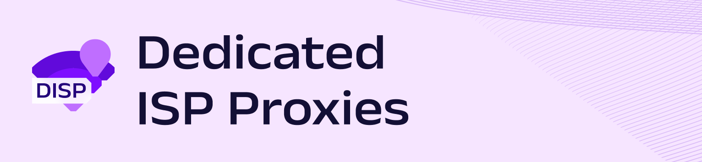

# Dedicated ISP Proxies



This repository provides a technical overview of how Oxylabs [Dedicated ISP Proxies](https://oxylabs.io/products/dedicated-isp-proxies) work, how they differ from other proxy types, and when they are best suited for scraping and automation workloads.

## What are Dedicated ISP Proxies?

Dedicated ISP proxies are a top-tier proxy solution designed for traffic-intensive web scraping tasks and public data access. They provide high speeds, stable connections, long-lasting sessions, and advanced customizability to minimize block rates and deliver the best performance.

They are designed to combine the **connection consistency and performance** of dedicated datacenter proxies with **reputation and trust** commonly associated with ISP and residential IPs.

### Core Features

- **Dedicated IP allocation** – each IP is assigned to a single user  
- **ISP-registered addresses** – tied to premium ASNs of your choice  
- **Unlimited bandwidth and session duration** – subject to Fair Usage Policy  
- **Stable gateway and port model** – no direct IP endpoint management  
- **Multi-protocol support** – HTTP, HTTPS, SOCKS5  
- **Flexible authentication** – credentials or IP whitelisting  
- **Centralized management** via dashboard  

**Note:** Dedicated ISP proxies acquired through enterprise and self-service plans use different management and access methods, but the core functions and behavior are the same.

## How Dedicated ISP Proxies Work

Dedicated ISP Proxies are provided as static IPs mapped to specific gateway ports. Each port corresponds to one dedicated IP and remains assigned for the duration of the subscription.

### Basic Setup Flow (Self-Service)

1. **Purchase and configure IPs.** Select locations and ASNs in the dashboard. Each IP is assigned to a dedicated port.
2. **Create proxy credentials.** Generate a username and password in the [Oxylabs dashboard](https://dashboard.oxylabs.io/en/).
3. **Send a test request.** Route traffic through the gateway and assigned port:
   ```bash
   curl -x https://disp.oxylabs.io:8001 -U user-USERNAME:PASSWORD https://ip.oxylabs.io/location
   ```

The sample request above consists of:

- **Host:** `disp.oxylabs.io`  
- **Port:** `8001` (the first IP on your proxy list)  
- **Credentials:** `user-USERNAME:PASSWORD` (“user-” prefix is mandatory, replace placeholders with your credentials)  
- **Request target:** `https://ip.oxylabs.io/location`  

If the request is successful, the response will display the IP address linked to the selected port. Since the IP is fixed to a port, the same address will be used across repeated or long-running sessions. Ports can be incremented (8002, 8003, etc.) to access additional IPs.

### Proxy list and port mapping

**Self-Service** users can access their proxy list in the Oxylabs dashboard and export it in JSON or CSV formats. Each proxy entry contains:

| Column       | Description                                      |
|--------------|--------------------------------------------------|
| Entry point  | The gateway to connect to your proxies           |
| Port         | The specific port that allows you to access a particular proxy from your list. |
| Country      | The geographic location of your proxies          |
| ISP (ASN)    | The provider and ASN identifier                  |
| Assigned IP  | A specific proxy IP assigned to the chosen port  |

**Enterprise users** receive proxy access details through account managers and internal provisioning systems. Proxy lists can also be managed via RESTful API. For more details, refer to [Enterprise proxy list documentation](https://developers.oxylabs.io/proxies/dedicated-isp-proxies/enterprise/proxy-lists).

### Available protocols

Dedicated ISP Proxies support the following protocols:

| Protocol | Request example |
|----------|-----------------|
| HTTP     | `curl -x http://disp.oxylabs.io:8000 -U user-USERNAME:PASSWORD https://ip.oxylabs.io/location` |
| HTTPS    | `curl -x https://disp.oxylabs.io:8000 -U user-USERNAME:PASSWORD https://ip.oxylabs.io/location` |
| SOCKS5 (`TCP` and `UDP`) | `curl -x socks5h://disp.oxylabs.io:8000 -U user-USERNAME:PASSWORD https://ip.oxylabs.io/location` |

**Note:** Make sure that the libraries or third-party tools you intend to use are compatible with `HTTPS` and `SOCKS5` protocols.

### Authentication

**Self-Service**

- Username and password authentication (managed via dashboard)
- IP whitelisting (up to 10 IPs in IPv4 format via dashboard)

**Enterprise**

- Username and password authentication (managed via account managers)
- IP whitelisting (managed via RESTful API or account manager)

## Dedicated ISP Proxies vs other proxy types

| Feature              | Dedicated ISP Proxies | Shared ISP Proxies | Residential Proxies | Dedicated Datacenter Proxies |
|----------------------|------------------------|---------------------|----------------------|-------------------------------|
| Source               | ISP ASN                | ISP ASN             | Ethically sourced residential IPs | Datacenter ASN |
| IP ownership         | Exclusive              | Shared              | Shared               | Exclusive                     |
| IP rotation          | Optional/Limited       | Limited             | Frequent             | Optional/Limited              |
| IP reputation / trust| Very high              | High                | Very high            | Low                           |
| Connection stability | Very high              | Medium              | Low-medium           | Very high                     |
| Typical use cases    | Persistent identity through long sessions | Budget ISP use | Large-scale IP rotation | High-speed automation |

## When to use Dedicated ISP Proxies

Dedicated ISP Proxies are best suited when:

- **Exclusive IP ownership is required** (e.g., maintaining logged-in sessions on authenticated platforms)
- **ISP-registered reputation is important** (e.g., accessing reputation-sensitive websites)
- **Long-lived sessions are critical** (e.g., continuous monitoring tools)
- **Predictable connection behavior is needed** (e.g., scheduled price or availability tracking)
- **Existing tooling relies on standard proxy protocols** (e.g., legacy scraping frameworks)

## Fair Usage Policy

To ensure stability and prevent any potential traffic abuse, the concurrent sessions of Dedicated ISP proxies are limited:

- **Until 100 GBs per 1 Dedicated ISP proxy in a month is reached**, concurrent sessions are limited to 100 per 1 Dedicated ISP Proxy.
- **If 100 GBs per 1 Dedicated ISP proxy is reached**, concurrent sessions are reduced to 10 per 1 Dedicated ISP Proxy for the remainder of the billing cycle.

## Learn more

For detailed configuration, advanced usage, and multi-language code examples, check out official Dedicated ISP Proxies documentation pages:

- [Self-Service documentation](https://developers.oxylabs.io/proxies/dedicated-isp-proxies/self-service)
- [Enterprise documentation](https://developers.oxylabs.io/proxies/dedicated-isp-proxies/enterprise)
- [Third-party integration guides](https://developers.oxylabs.io/proxies/integration-guides/dedicated-isp-proxies-integrations)

## Contact us

If you have questions or need support, reach out to us at hello@oxylabs.io, through [live chat](https://oxylabs.drift.click/oxybot), or join our [Discord community](https://discord.gg/Pds3gBmKMH). For Enterprise-related inquiries, contact your dedicated account manager.
